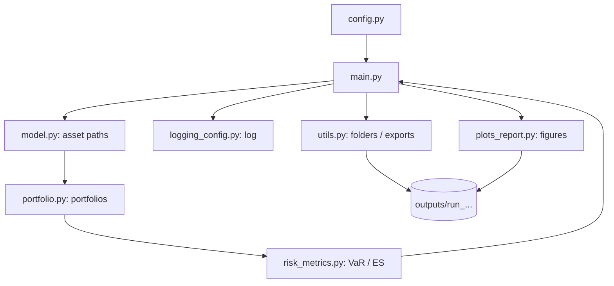

# Portfolio Risk Simulation Framework
## Technical & Execution Guide | v2.1

**Code reviewed:** 8 November 2026  
**Purpose:** help a new reader install, configure, run and understand the *current* Python project.  
**Companion material:** the scientific report covers mathematical definitions, model assumptions and interpretation of results. This guide documents the software workflow rather than reproducing those derivations.


---
## 1. Project overview

This project simulates two financial assets under the Black–Scholes / geometric Brownian motion (GBM) model and combines their paths into three portfolio profiles. It then estimates and compares portfolio risk using empirical (simulation-based) and approximate Gaussian Value at Risk (VaR) and Expected Shortfall (ES). Rolling calculations evaluate risk forecasts from each simulated scenario's past losses. The program saves data, logs, summaries and figures for subsequent analysis.

The two assets may be **independent** or simulated jointly with a configurable **correlation**. One execution uses one of these modes: comparing them requires separate runs and subsequent analysis of their outputs.

**What this release actually includes:** two simulated assets, three constant-weight portfolios, static VaR/ES, rolling VaR/ES, VaR exception statistics, rolling ES tail diagnostics, CSV/JSON exports and plots.

> **Reading guide:** if your goal is simply to execute the project, read Sections 2–5, run the command in Section 5, then use Sections 6–7 to follow what happens and locate the generated files. Section 8 is a compact function reference.

## 2. Project files

Place these modules together in the project root:

```text
project_root/
├── main.py                 # Main entry point: runs the end-to-end pipeline
├── config.py               # Central configuration and output switches
├── model.py                # Simulates individual or correlated GBM asset paths
├── portfolio.py            # Builds weighted portfolio returns, losses and values
├── risk_metrics.py         # Static and rolling VaR/ES calculations
├── plots_report.py         # Plot functions imported by main.py
├── utils.py                # Output directory creation, JSON/CSV saving
├── logging_config.py      # Writes run messages to console and log file
├── plots.py                # Separate plotting module; not imported by main.py
├── BrownianMotion.py       # Standalone Brownian-path illustration; not in main pipeline
├── requirements.txt       # Dependency list supplied with this documentation
└── outputs/                # Created automatically when the program runs
```

`requirements.txt` is an accompanying attachment and should be placed in the project root. The names above reflect the supplied Python code. Additional report-specific plotting scripts, which are executed independently of the main pipeline, are documented in **Section 10 – Additional Plotting Scripts**.

### 2.1 How modules communicate



The arrows describe the **execution and data flow**, not a literal list of Python `import` statements: `main.py` coordinates the separate modules and passes their results onward.

## 3. Requirements and setup

**Recommended setup:** Python 3.10 or newer (the source uses `str | Path` type annotations), a terminal, and a dedicated virtual environment. The code imports **NumPy**, **Pandas**, **Matplotlib** and **SciPy** (`scipy.stats.gaussian_kde` in `plots_report.py`); standard-library modules require no separate installation. Use the accompanying `requirements.txt` for the exact dependency list maintained with the project.

From the project root:

```bash
# Windows PowerShell
py -m venv .venv
.venv\Scripts\Activate.ps1
python -m pip install -r requirements.txt
```

```bash
# macOS / Linux
python3 -m venv .venv
source .venv/bin/activate
python -m pip install -r requirements.txt
```

If PowerShell blocks script activation, use the environment's Python executable directly (for example `.venv\Scripts\python.exe -m pip install -r requirements.txt`). Commands assume `requirements.txt` has been placed alongside `main.py`.

## 4. Configure a run (`config.py`)

Edit `config.py` **before** launching `main.py`. No command-line arguments are parsed by the current program; configuration is done by changing these constants.

| Setting | Current value | Effect |
|---|---|---|
| `N_SCENARIOS` | `1000` | Number of independent market scenarios (rows) |
| `N_STEPS` | `1000` | Number of returns per scenario (time steps) |
| `TRADING_DAYS_PER_YEAR` | `252` | Used to convert steps to years |
| `T_YEARS` | `N_STEPS / TRADING_DAYS_PER_YEAR` | Total simulated horizon |
| `SEED` | `42` | Enables repeatable random simulations |
| `INITIAL_PORTFOLIO_VALUE` | `100.0` | Starting value for each portfolio path |
| `MODEL_NAME` | `"black_scholes"` | Only currently implemented model |
| `BS_SIMULATION_MODE` | `"independent"` | `"independent"` or `"correlated_pair"` |
| `BS_CORRELATION` | `0.0` | Correlation passed in correlated-pair mode |
| `VAR_LEVELS` | `[0.95, 0.99]` | Risk confidence levels |
| `ROLLING_WINDOW_SIZES` | `[100, 200, 250]` | Number of past losses per forecast |
| `ROLLING_STEP_SIZE` | `1` | Forecast/test frequency |
| `PLOT_EXAMPLES` | `True` | Controls plots generated by `main.py` |
| `N_PATHS_TO_PLOT` | `5` | Number of paths in basic path plots |
| `SCENARIO_ID_TO_PLOT` | `0` | Selected scenario for two-asset example |
| `SAVE_RUN_DATA` | `True` | Controls configuration/portfolio base-data saving |
| `SAVE_MARKET_PATHS` | `False` | Additional asset path CSVs, only if `SAVE_RUN_DATA=True` |
| `SAVE_PORTFOLIO_PATHS` | `False` | Additional portfolio value CSVs, only if `SAVE_RUN_DATA=True` |
| `OUTPUT_DIR` / `LOG_DIR` / `DATA_DIR` | `"outputs"` / `"logs"` / `"data"` | Directory names |

### 4.1 Asset parameters

| Asset key | Initial price `s0` | Annual drift `mu` | Annual volatility `sigma` |
|---|---:|---:|---:|
| `low_vol` | 100 | 0.05 | 0.10 |
| `high_vol` | 100 | 0.08 | 0.45 |

### 4.2 Portfolio profiles

| Profile ID | Name | Low-vol weight | High-vol weight |
|---|---|---:|---:|
| 1 | `NoStressed` | 0.75 | 0.25 |
| 2 | `Equalweight` | 0.50 | 0.50 |
| 3 | `Stressed` | 0.25 | 0.75 |

`config.py` stores `w_high`; the corresponding `w_low` is calculated automatically as `1 - w_high`. At every time step, weights are implicitly restored to their configured proportions. The label `Stressed` refers to **greater exposure to the high-volatility asset**, not an implemented stress-event model.

**To simulate correlated assets**, edit for example:

```python
BS_SIMULATION_MODE = "correlated_pair"
BS_CORRELATION = 0.5
```

With `"independent"`, the program uses zero effective correlation for the Gaussian benchmark even if `BS_CORRELATION` has a different value. In correlated mode, Cholesky decomposition currently requires `-1 < BS_CORRELATION < 1` (the code's initial bounds check also admits endpoints, which would fail at decomposition).

## 5. Run the program

From the directory containing `main.py`, with the environment activated:

```bash
python main.py
```

You should see logging messages for market simulation, portfolio construction, static risk measures, rolling VaR, rolling ES, saving and (when enabled) plotting. Each run creates a timestamped folder such as `outputs/run_20261108_103000/`. The directory ID is generated with second-level timestamp precision, so two executions started within the same second may reuse the same folder.

**Practical first run:** keep `MODEL_NAME="black_scholes"`, `BS_SIMULATION_MODE="independent"` and `SAVE_RUN_DATA=True`. The default combination of 1,000 scenarios, 1,000 steps and several rolling windows can take meaningful time and memory, particularly during rolling-ES calculations. For a quicker smoke test, reduce `N_SCENARIOS` and `N_STEPS`, while ensuring all rolling windows remain smaller than `N_STEPS`.

## 6. Execution workflow: what `main.py` calls, in order

This section follows the source code rather than the theoretical order used in the paper. Inputs and returned objects are named exactly as used by the implementation.

### Step 1 — Initialize run directories and logging

**Caller:** `main.py`  
**Calls:** `utils.create_run_id()` → `utils.create_run_directories()` → `logging_config.setup_logger()`.

1. `create_run_id()` generates a timestamp string.
2. `create_run_directories()` creates the run folder and its `logs/` and `data/` subfolders.
3. `main.py` creates `figures/`.
4. `setup_logger()` configures terminal and file messages at `logs/run_output.log`.

**Result:** `run_paths`, a dictionary of output locations, and a logger.


### Step 2 — Simulate the market (`model.py`)
**Caller:** `main.py` → `simulate_market(model_name=..., ...)`.

The dispatcher currently accepts only `"black_scholes"` and delegates to `simulate_black_scholes_market(...)`. The latter chooses:

- `"independent"`: calls `simulate_black_scholes_paths(...)` twice, once for each asset, using `SEED` and `SEED + 1` when a seed is supplied.
- `"correlated_pair"`: calls `simulate_correlated_black_scholes_pair(...)` once; the two shocks are coupled using a correlation matrix and Cholesky decomposition.

**Input:** `BS_ASSETS`, scenario count, step count, time horizon, mode, correlation and seed.  
**Output:** `market_paths = {"low_vol": ..., "high_vol": ...}`. Each array has shape `(N_SCENARIOS, N_STEPS + 1)`; column 0 contains the initial prices. `main.py` also logs the two array shapes.


### Step 3 — Build the three portfolios (`portfolio.py`)
**Caller:** `main.py` → `build_all_portfolios(market_paths, PORTFOLIO_PROFILES, INITIAL_PORTFOLIO_VALUE)`.

`build_all_portfolios()` iterates over the configured profile IDs and calls `build_rebalanced_portfolio(...)` for each. That function:

1. Calls `get_portfolio_weights()` for the profile's weights and name.
2. Calls `compute_simple_returns()` on each asset path matrix.
3. Computes each portfolio's simple one-step returns as the weighted sum of asset returns.
4. Sets `portfolio_losses = -portfolio_returns`. Positive losses denote adverse portfolio returns; negative losses denote gains.
5. Reconstructs `portfolio_values` by compounding each step's portfolio return from the configured initial value.

**Output:** `portfolios`, a dictionary indexed by profile ID. Each entry contains `profile_name`, `weights`, `portfolio_returns` `(M,N)`, `portfolio_losses` `(M,N)` and `portfolio_values` `(M,N+1)`.


### Step 4 — Save configuration and base data (`utils.py`)
**Condition:** runs only if `SAVE_RUN_DATA=True`.

`main.py` creates a `config_snapshot` dictionary and saves `data/config_snapshot.json` with `save_json()`. When `SAVE_MARKET_PATHS=True`, `save_market_paths()` writes asset-price matrices. It then calls `save_portfolio_outputs()` to export returns, losses and portfolio metadata; portfolio values are written too only if `SAVE_PORTFOLIO_PATHS=True`.


### Step 5 — Create basic trajectory figures (`plots_report.py`)
**Condition:** `PLOT_EXAMPLES=True`.

`main.py` calls `plot_two_asset_examples()` for a single paired scenario; `plot_trajectories()` separately for low-volatility paths, high-volatility paths and each of the three portfolio-value matrices. These plots are written to `figures/`. Their `show=True` setting also requests display, so behavior depends on the local Matplotlib backend.


### Step 6 — Compute static VaR and ES (`risk_metrics.py`)
For **each portfolio** and **each `alpha` in `VAR_LEVELS`**, `main.py` calls:

- `compute_theoretical_gaussian_portfolio_var()` and `compute_theoretical_gaussian_portfolio_es()`: produce one-step approximate Gaussian benchmarks from weights, asset drifts, volatilities and effective correlation.
- `compute_historical_var(..., aggregate=True)` and `compute_historical_es(..., aggregate=True)`: compute empirical estimates using all simulated one-step losses pooled across scenarios and time steps.

The results are written into `risk_metrics_summary["historical_and_theoretical"]`. The word *historical* is retained in function and JSON keys, but these losses are **simulated**, not observed historical market data.

**Interpretation:** the Gaussian values are benchmarks based on a normal approximation for **simple portfolio returns**, not exact risk measures for the simulated rebalanced portfolio.


### Step 7 — Estimate and assess rolling VaR (`risk_metrics.py`)
For every portfolio, confidence level and window length, `main.py` calls `compute_rolling_var()` and logs the text returned by `summarize_rolling_var_result()`.

For **each simulated scenario separately**, the function takes only the last `window_size` *past* one-step losses, estimates their empirical VaR quantile, and compares the forecast to the **next** realized loss. It repeats this every `ROLLING_STEP_SIZE` steps. A strict exceedance (`realized_loss > forecast`) is counted as a VaR exception.

**Output:** rolling forecast arrays, realized-loss arrays, exception flags, the total exception count, forecast count, observed exception rate and expected rate `1 - alpha`. The summary stored in `risk_metrics_summary["rolling_var"]` contains the scalar backtest statistics.

For `N_STEPS=1000`, window 100 and step size 1, there are 900 forecasts **per scenario** (900,000 across 1,000 scenarios). This is a pooled count of scenario-by-time forecasts, not a single historical live backtest.


### Step 8 — Estimate rolling ES and tail diagnostics (`risk_metrics.py`)
For the same portfolios, confidence levels and windows, `main.py` calls `compute_rolling_es()` and `summarize_rolling_es_result()`.

The function estimates a window-specific VaR and the **mean of losses at or above that window's VaR**; this mean is the empirical rolling ES. `main.py` then compares future realized losses with the **rolling VaR forecast** to select exception cases, and reports:

- mean, minimum and maximum rolling ES forecast;
- count and frequency of **VaR** exceptions;
- average realized loss on those exceptions;
- average ES forecast on the same exceptions;
- `mean_tail_gap` = average realized tail loss minus average ES forecast on exceptions.

**Output:** `risk_metrics_summary["rolling_es"]`, with aggregates rather than full rolling ES forecast matrices.


### Step 9 — Write the final risk summaries (`utils.py`)
`main.py` saves these files **regardless of the `SAVE_RUN_DATA` flag**:

- `risk_metrics_summary.json` via `save_json()`;
- `risk_metrics_static_summary.csv` via `save_static_risk_metrics_summary_csv()`;
- `rolling_var_summary.csv` via `save_rolling_var_summary_csv()`;
- `rolling_es_summary.csv` via `save_rolling_es_summary_csv()`.

The program also writes progress and result messages to the log. The JSON summary is nested by category → portfolio → confidence level → (for rolling results) window size; the CSV summaries flatten this information for easier comparison.

### Step 10 — Generate risk-analysis figures (`plots_report.py`)
**Condition:** `PLOT_EXAMPLES=True`. After the summary files have been saved, `main.py` creates `figures/risk_analysis/` and generates:

| Function called from `main.py` | What the plot shows | How many with default settings |
|---|---|---:|
| `plot_static_var_comparison_by_portfolio` | Gaussian vs empirical static VaR | 2 |
| `plot_static_es_comparison_by_portfolio` | Gaussian vs empirical static ES | 2 |
| `plot_rolling_var_exception_rates` | Observed vs expected VaR exception rates | 2 |
| `plot_loss_distribution_with_var_es` | One portfolio's simulated loss histogram with VaR/ES thresholds | 6 |
| `plot_loss_distributions_comparison` | Three portfolios' loss densities (KDE, for visualization only) | 1 |
| `plot_mean_rolling_var_vs_es_over_time` | Across-scenario mean rolling VaR vs ES | 18 |
| `plot_tail_premium_by_portfolio` | ES minus VaR, empirical and Gaussian | 4 |
| `plot_mean_rolling_es_by_portfolio_and_window` | Average rolling ES across portfolios and windows | 2 |
| `plot_realized_tail_loss_vs_es_forecast` | Tail loss vs ES on VaR exception cases | 6 |
| `plot_mean_tail_gap_by_portfolio` | Realized tail loss minus corresponding ES forecast | 6 |

The table describes the **actual invoked functions**, not everything defined in `plots_report.py`. Two relevant functions present but **not called** are `plot_asset_trajectories_comparison()` and `plot_independent_vs_correlated_risk_comparison()`; the latter would require independently produced run summaries. The main pipeline does not automatically perform cross-run comparisons.

### Step 11 — Completion

`main.py` writes its completion message. The output files remain on disk for inspection and independent analyses.

## 7. Output folders and how to use them

A normal run with `SAVE_RUN_DATA=True`, `PLOT_EXAMPLES=True`, `SAVE_MARKET_PATHS=False` and `SAVE_PORTFOLIO_PATHS=False` produces the following principal structure:

```text
outputs/
└── run_YYYYMMDD_HHMMSS/
    ├── logs/
    │   └── run_output.log
    ├── data/
    │   ├── config_snapshot.json
    │   ├── risk_metrics_summary.json
    │   ├── risk_metrics_static_summary.csv
    │   ├── rolling_var_summary.csv
    │   ├── rolling_es_summary.csv
    │   └── portfolios/
    │       ├── portfolio_metadata.csv
    │       ├── 1_NoStressed_returns.csv
    │       ├── 1_NoStressed_losses.csv
    │       ├── 2_Equalweight_returns.csv
    │       ├── 2_Equalweight_losses.csv
    │       ├── 3_Stressed_returns.csv
    │       └── 3_Stressed_losses.csv
    └── figures/
        ├── asset_example_low_vs_high.png
        ├── low_vol_paths.png
        ├── high_vol_paths.png
        ├── portfolio_1_NoStressed_paths.png
        ├── portfolio_2_Equalweight_paths.png
        ├── portfolio_3_Stressed_paths.png
        └── risk_analysis/
            └── [risk-analysis PNG figures described in Step 10]
```

When `SAVE_MARKET_PATHS=True`, two extra asset-path CSVs appear in `data/market_paths/`. When `SAVE_PORTFOLIO_PATHS=True`, each portfolio also has a `*_values.csv` file. When `PLOT_EXAMPLES=False`, the automatic plots and `risk_analysis` folder are skipped, although `main.py` still creates the base `figures/` directory. When `SAVE_RUN_DATA=False`, the configuration snapshot and portfolio exports are skipped, **but final risk summary JSON/CSV files are still saved**.

**Where to start:** inspect `data/config_snapshot.json` to identify the run setup; `risk_metrics_static_summary.csv` for per-portfolio static comparisons; `rolling_var_summary.csv` for VaR exception rates; `rolling_es_summary.csv` for rolling ES and tail diagnostics; `portfolios/*_losses.csv` for raw one-step loss samples; and `logs/run_output.log` to review messages.

**CSV convention:** each array file is one row per scenario, plus columns `t_0`, `t_1`, etc. A price/value matrix includes the initial state, while a return/loss matrix has only the subsequent one-step observations. Numeric losses such as `0.02` correspond to **2%**. No conversion into currency loss is performed.

## 8. Function reference by module

This is a navigation index, not a repetition of the mathematical theory.

| Module | Functions | Purpose / use |
|---|---|---|
| `model.py` | `simulate_black_scholes_paths`; `simulate_correlated_black_scholes_pair`; `simulate_black_scholes_market`; `simulate_market` | Single-asset generation, paired generation, market wrapper and model dispatcher |
| `portfolio.py` | `compute_simple_returns`; `get_portfolio_weights`; `build_rebalanced_portfolio`; `build_all_portfolios` | From asset paths to per-step returns, losses and portfolio value paths |
| `risk_metrics.py` | `_extract_losses`; `_normal_pdf`; `_validate_alpha` | Internal extraction, Gaussian density and confidence-level validation |
| `risk_metrics.py` | `compute_theoretical_gaussian_portfolio_var`; `compute_theoretical_gaussian_portfolio_es`; `compute_historical_var`; `compute_historical_es` | Static Gaussian benchmarks and empirical simulated estimates |
| `risk_metrics.py` | `compute_rolling_var`; `summarize_rolling_var_result`; `compute_rolling_es`; `summarize_rolling_es_result` | Per-scenario rolling estimates and readable diagnostics |
| `utils.py` | `create_run_id`; `create_run_directories`; `save_json`; `save_array_to_csv`; `save_market_paths`; `save_portfolio_outputs` | Directory setup and raw data exports |
| `utils.py` | `save_static_risk_metrics_summary_csv`; `save_rolling_var_summary_csv`; `save_rolling_es_summary_csv` | Risk-summary CSV exports |
| `logging_config.py` | `setup_logger` | Console/file logging |
| `main.py` | `main` | Orchestration from setup to final reports and figures |
| `plots_report.py` | `plot_trajectories`; `plot_two_asset_examples`; `compute_common_ylim`; `plot_asset_trajectories_comparison` | Trajectories and common-axis comparison; comparison helper is available but unused by main |
| `plots_report.py` | `plot_static_var_comparison_by_portfolio`; `plot_static_es_comparison_by_portfolio`; `plot_rolling_var_exception_rates`; `plot_mean_rolling_var_vs_es_over_time`; `plot_loss_distribution_with_var_es`; `plot_loss_distributions_comparison`; `plot_tail_premium_by_portfolio`; `plot_mean_rolling_es_by_portfolio_and_window`; `plot_realized_tail_loss_vs_es_forecast`; `plot_mean_tail_gap_by_portfolio` | Risk figures generated by `main.py` |
| `plots_report.py` | `plot_independent_vs_correlated_risk_comparison`; `_finalize_plot`; `_get_ordered_static_summary_rows` | Optional comparison across two externally provided run summaries, plus plotting helpers |
| `plots.py` | Alternative versions of basic/risk plotting functions (see source file) | **Not imported or executed by `main.py`** |
| `BrownianMotion.py` | `simulate_brownian_paths`; `plot_brownian_paths`; `main` | Independent Brownian-motion figure script; run with `python BrownianMotion.py` if needed |

`BrownianMotion.py` writes `figures/brownian_paths.png` and `figures/brownian_paths.pdf` relative to the working directory. These files do **not** belong to the timestamped output of `main.py` unless you explicitly adapt the paths.

## 9. Operational notes and limitations

1. **Different estimation samples:** static empirical VaR/ES pool all scenario/time one-step losses; rolling estimates use each scenario's own past observations. They answer different estimation questions.
2. **Gaussian benchmark is approximate:** despite the Black–Scholes model used for asset paths, weighted *simple* portfolio returns are not generally exactly normally distributed.
3. **Empirical quantile convention:** the implementation uses `np.quantile()` (linear interpolation by default), not necessarily the nearest order statistic. Empirical ES includes all observations at or beyond this computed threshold.
4. **Rolling estimates do not look ahead:** each forecast window precedes its evaluated realized loss. The exception-rate summary aggregates across the simulated paths and test points.
5. **ES tail comparison is descriptive:** the `mean_tail_gap` comparison selects observations where rolling **VaR** was exceeded. It is not a formal standalone ES calibration/backtesting procedure.
6. **JSON with missing tail events:** if no exceptions occur, some stored statistics are `NaN`; Python's default JSON writer permits this nonstandard JSON token, which strict parsers may reject.
7. **Correlated boundary values:** exactly `rho = -1` or `rho = 1` pass the explicit range check but fail the current Cholesky factorization.
8. **Display and performance:** initial figures request `show=True`; large rolling arrays, percentiles and graphics may require substantial memory or time. `PLOT_EXAMPLES=False` disables generated figures, not the metric computations.
9. **No integrated tests or CLI:** no automated test suite, argument parser, package installer or scheduler is included in the supplied Python source.
10. **Scope of this guide:** it documents the current code. Report methodology and future extensions should remain in the report or in separate research material rather than being represented as implemented behavior.


## 10. Additional Report-Specific Scripts

### 10.1 Overview and Purpose

In addition to the main simulation framework described in the previous sections, the project includes a set of standalone Python scripts developed specifically to support the preparation of the scientific report.

These scripts are **not part of the main execution pipeline** and are not automatically invoked by `main.py`. Instead, they are executed independently, using simulation results previously generated and stored in the `outputs/` directory.

Their primary purposes are to:

- Generate report-specific figures with customized layouts and comparisons.
- Recompute selected risk measures from previously saved portfolio losses.
- Extract numerical results and organize them into tables suitable for publication.
- Compare risk estimates across portfolio profiles, rolling-window sizes and correlation settings.
- Validate selected numerical results before their inclusion in the report.

These utilities do not simulate new market trajectories or construct new portfolios. They operate on existing results, preserving the separation between the core simulation framework and the subsequent reporting activities.

### 10.2 Execution Requirements

Before running any of the scripts described below, the corresponding simulations must have been completed using `main.py`.

The scripts expect the required input files to be available within the appropriate run directories, typically under:

- `outputs/<run_name>/data/portfolios/`
- `outputs/<run_name>/data/risk_metrics_summary.json`

Depending on the script, users must configure the target run, portfolio, confidence level or rolling-window parameters directly in the source code.

Some utilities use `Path(__file__).resolve().parent` to identify the project directory automatically. Others contain an absolute Windows path assigned to `BASE_DIR`, which must be updated to match the local environment before execution.

All scripts should be executed using the same Python environment as the main project, with the dependencies listed in `requirements.txt` installed.

The commands below assume that the terminal is opened in the directory containing the corresponding scripts.

### 10.3 `main_plot_loss_distribution_var_es.py`

**Purpose**

This script generates empirical loss-distribution figures for the three portfolio profiles, displaying Value at Risk and Expected Shortfall at both the 95% and 99% confidence levels.

Unlike the standard plotting procedure, which generates separate figures for different confidence levels, this utility displays all four risk thresholds in a single figure for each portfolio.

**Main functions**

- `load_losses(filepath)`: reads a portfolio loss CSV, removes the `scenario_id` column, flattens the remaining loss matrix into a single sample and filters out non-finite observations.
- `empirical_var_es(losses, alpha)`: computes empirical VaR using `np.quantile()` and empirical ES as the average of losses greater than or equal to the VaR threshold.
- `plot_loss_distribution_var_es(losses, portfolio_name, output_dir)`: generates a histogram with VaR and ES reference lines at 95% and 99%, saves the figure and returns the calculated values.
- `main()`: processes the three configured portfolios and prints the risk measures and generated file paths.

**Inputs**

The script reads the three portfolio loss files from:

`outputs/<run_name>/data/portfolios/`

The target simulation is selected by modifying `RUN_NAME`.

**Execution**

`python main_plot_loss_distribution_var_es.py`

**Outputs**

Three PNG figures are generated in:

`outputs/<run_name>/figures/risk_analysis/`

Each file follows the naming convention:

`loss_distribution_var_es_95_99_<portfolio_name>.png`

The script also prints the corresponding empirical VaR and ES estimates to the terminal.

### 10.4 `main_plot_rolling_portfolio_comparison.py`

**Purpose**

This script compares the evolution of rolling VaR and rolling ES across the three portfolio profiles for a selected simulation run.

It produces a two-panel figure: the first panel compares mean rolling VaR trajectories, while the second compares mean rolling ES trajectories.

**Main functions and execution flow**

- `load_losses(file_path)`: loads a two-dimensional portfolio loss matrix from CSV.
- `compute_rolling_var()`: imported from `risk_metrics.py` and used to compute scenario-specific rolling VaR forecasts.
- `compute_rolling_es()`: imported from `risk_metrics.py` and used to compute scenario-specific rolling ES forecasts.

For each portfolio, the script calculates the average forecast across scenarios at every eligible time step, producing a time series of mean rolling VaR and mean rolling ES.

The plotting and data-processing workflow is executed at module level rather than through a dedicated `main()` function.

**Configuration**

The main parameters are:

- `RUN_NAME`: selected simulation directory.
- `ALPHA`: confidence level, currently 0.95.
- `WINDOW_SIZE`: rolling-window length, currently 250.
- `STEP_SIZE`: forecast evaluation frequency, currently 1.

The script also attempts to extract the correlation coefficient from the run directory name for use in the figure title and output filename.

**Execution**

`python main_plot_rolling_portfolio_comparison.py`

**Outputs**

A PNG figure is saved in:

`outputs/<run_name>/figures/risk_analysis/`

The filename follows the pattern:

`mean_rolling_var_es_portfolio_comparison_rho_<rho>_alpha_<alpha>_window_<window>.png`

The correlation component is omitted if it cannot be extracted from the run name.

The figure provides a direct visual comparison of the risk estimates associated with different portfolio allocations under the same simulation setting.

### 10.5 `main_plot_rolling_var_es_window_comparison.py`

**Purpose**

This script analyzes how the choice of rolling-window length affects estimated VaR and ES for a selected portfolio.

It is designed to support the comparison between shorter and longer estimation windows, highlighting differences in the variability and evolution of risk forecasts.

**Main execution flow**

The script:

1. Loads the saved portfolio loss matrix.
2. Computes rolling VaR and rolling ES for each configured window size using functions imported from `risk_metrics.py`.
3. Averages the forecasts across scenarios at each time step.
4. Plots the resulting time series on a common figure.
5. Saves the figure as a PNG file.

The script does not define a separate `main()` function. Its operations are performed directly when the file is executed.

**Configuration**

The principal parameters are:

- `RUN_NAME`: target simulation.
- `PROFILE_ID` and `PORTFOLIO_NAME`: selected portfolio.
- `ALPHA`: confidence level, currently 0.95.
- `WINDOWS`: rolling-window lengths, currently `[100, 250]`.
- `STEP_SIZE`: forecast evaluation frequency.

The plotting section explicitly references windows of 100 and 250 observations. Changing `WINDOWS` therefore also requires updating the corresponding plotting statements.

**Execution**

`python main_plot_rolling_var_es_window_comparison.py`

**Outputs**

The figure is saved in:

`outputs/<run_name>/figures/risk_analysis/`

with the filename:

`mean_rolling_var_es_window_comparison_<profile_id>_<portfolio_name>_alpha_<alpha>.png`

### 10.6 `extract_es_tail_table.py`

**Purpose**

This utility extracts rolling Expected Shortfall tail diagnostics from the risk metrics summary generated by the main pipeline.

Its purpose is to transform the nested JSON results into a structured CSV table suitable for inspecting and reporting the severity of losses observed during VaR exceptions.

**Main execution flow**

The script reads:

`outputs/<run_name>/data/risk_metrics_summary.json`

It accesses the `rolling_es` section and extracts, for each portfolio, confidence level and rolling-window size:

- `mean_realized_tail_loss`: average realized loss over observations exceeding the corresponding rolling VaR forecast.
- `mean_es_forecast_on_exceptions`: average ES forecast over those same observations.
- `mean_tail_gap`: difference between the two quantities.

The script also converts these values into percentage-based representations for easier inclusion in the scientific report.

The extracted records are organized in a Pandas DataFrame and sorted by confidence level, window size and portfolio identifier.

The operations are performed directly at module level.

**Configuration**

The relevant variables are:

- `BASE_DIR`: project directory, currently specified as an absolute path.
- `RUN_NAME`: selected simulation.
- `ALPHAS`: confidence levels, currently `[0.95, 0.99]`.
- `WINDOW_SIZES`: rolling-window lengths, currently `[100, 200, 250]`.

**Execution**

`python extract_es_tail_table.py`

**Outputs**

The script prints formatted summary tables to the terminal and saves:

`outputs/<run_name>/data/risk_analysis/es_tail_diagnostics_table.csv`

This file provides both the original risk values and their percentage representations.

The diagnostics describe the observed severity of VaR exceptions relative to the estimated ES. They should not be interpreted as a formal standalone ES backtesting procedure.

### 10.7 `extract_rolling_risk_table.py`

**Purpose**

This script performs a cross-run comparison of rolling VaR and rolling ES estimates under different asset-correlation settings.

It supports the construction and verification of the correlation-sensitivity table used in the scientific report.

Unlike the previous utilities, this script processes multiple simulation runs rather than a single run.

**Main functions**

- `find_run_dir(rho)`: identifies the directory associated with a selected correlation coefficient. It can automatically select the latest matching run or use a manually specified run.
- `find_one(run_dir, filename)`: searches recursively for a required file and checks that exactly one match exists.
- `load_losses(run_dir)`: loads the selected portfolio loss matrix, removes the scenario identifier and validates its dimensions and numerical contents.
- `mean_rolling_var(losses)`: recomputes rolling VaR using scenario-specific historical windows and returns the average forecast across all evaluated scenarios and time steps.
- `load_mean_rolling_es(run_dir)`: reads the previously calculated `mean_es_forecast` from the saved risk metrics JSON.
- `main()`: processes the configured correlation values, builds the comparison table, prints formatted results and exports the CSV.

**Configuration**

The script currently uses:

- `RHO_VALUES = (0.0, 0.3, 0.7)`
- `PORTFOLIO_NAME = "Equalweight"`
- `PORTFOLIO_FILE = "2_Equalweight_losses.csv"`
- `ALPHA = 0.95`
- `WINDOW_SIZE = 250`

When `USE_LATEST_RUN_AUTOMATICALLY=True`, run directories are selected using the naming prefix `rho<value>_run_`.

Alternatively, individual runs can be specified through `MANUAL_RUNS`.

**Execution**

The uploaded script is named `extract_rolling_risk_table(1).py`, so it can be executed as:

`python "extract_rolling_risk_table(1).py"`

If renamed to `extract_rolling_risk_table.py`, the command becomes:

`python extract_rolling_risk_table.py`

**Outputs**

The script generates a table containing the selected correlation, mean rolling VaR, mean rolling ES and source run identifier.

It prints the results to the terminal, including formatted LaTeX table rows, and saves:

`main_plot_report/rolling_risk_correlation_table_check.csv`

Unlike the other utilities, this CSV is saved in a dedicated project-level reporting directory rather than inside an individual simulation run.

The calculation of mean rolling VaR is performed directly from the saved portfolio losses, while mean rolling ES is retrieved from the previously computed summary. This distinction should be preserved when interpreting the results.

### 10.8 Report Data and Supporting Files

The report-specific scripts mainly use two categories of previously generated data:

**Portfolio loss matrices:** CSV files containing one-step percentage losses for each simulated scenario. These are used to reconstruct empirical loss distributions and rolling risk estimates.

**Risk metrics summaries:** JSON files containing the risk measures and diagnostics calculated during the execution of `main.py`. These are used to extract previously calculated ES statistics and compare simulation runs.

The additional file `rolling_risk_correlation_table_check.csv` is a reporting output associated with the correlation-sensitivity analysis, not an executable Python module.

It contains the columns `rho`, `mean_rolling_var`, `mean_rolling_es` and `run`, allowing the reported numerical estimates to be traced to their source simulations.

### 10.9 Operational Notes

The additional scripts are intended for research reporting and numerical verification, rather than as mandatory components of the main simulation framework.

The following operational considerations apply:

1. **Independent execution:** running `main.py` does not automatically execute these scripts. Each utility must be launched separately when its output is required.
2. **Existing simulation data:** the scripts depend on previously generated files. Missing run directories or required CSV/JSON files may prevent execution.
3. **Path configuration:** scripts containing absolute paths must be adapted to the user's local project directory.
4. **Run selection:** the correct `RUN_NAME` or correlation-specific run must be selected before generating report results.
5. **Parameter consistency:** confidence levels, rolling-window lengths and portfolio identifiers should be consistent with the simulation results and the analysis presented in the paper.
6. **Output separation:** report-specific plots and extracted tables should be distinguished from the outputs automatically generated by the main pipeline.
7. **Code dependencies:** scripts that import `risk_metrics.py` must be executed in an environment where that module is accessible.
8. **Reproducibility:** each published figure or table should remain traceable to the simulation run and parameters from which it was generated.

These scripts extend the reporting and validation capabilities of the project without modifying the underlying simulation methodology. Their role is to facilitate the preparation, interpretation and verification of the numerical results presented in the scientific report.


---

**End of Technical & Execution Guide v2.1.**
